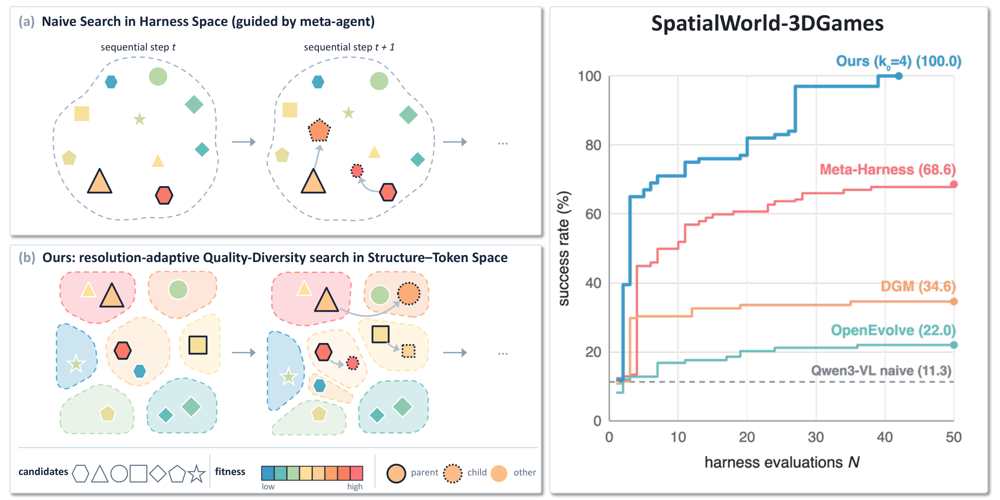

<h1 align="center">Harness-MAP</h1>

<p align="center"><b>Budget-Efficient Harness Search via Structure-Token Factorization</b></p>

<p align="center">
  <a href="https://yuanapril.github.io/">Mei Yuan</a> ·
  <a href="https://zdxdsw.github.io/">Yingshan Chang</a> ·
  <a href="https://dpfried.github.io/">Daniel Fried</a> ·
  <a href="https://yonatanbisk.com/">Yonatan Bisk</a><br>
  Carnegie Mellon University
</p>

<p align="center">
  <a href="https://drive.google.com/file/d/1y0b185BGWgLylrryYU_cPm4ZFyRX8sHR/view?usp=sharing"></a>
  <a href="https://harness-map.github.io/"></a>
  <a href="https://x.com/"></a>
</p>
<!-- TODO: point the arXiv badge at the arXiv abstract page once the id is assigned, and the X badge at the announcement thread. -->

<p align="center"></p>

<p align="center"><sub><b>Figure 1.</b> <b>(a)</b> A meta-agent searching harness space directly follows one lineage at a time and collapses into local edits. <b>(b)</b> Harness-MAP places every candidate in a structure–token map, breeds from many cells at once, and sub-splits the cells whose fitness varies as the search proceeds. <b>Right:</b> success rate against the number of harness evaluations on SpatialWorld-3DGames with a frozen Qwen3-VL-30B-A3B-Instruct: Harness-MAP (k<sub>0</sub> = 4) reaches 100% inside the 50-evaluation budget, where Meta-Harness, DGM and OpenEvolve reach 68.6%, 34.6% and 22.0%.</sub></p>

## Overview

Harness-MAP evolves the **harness** of an agent — the orchestration code, prompts, skills, tools and
memory wrapped around a frozen LLM/VLM — under a tight evaluation budget. Letting a meta-agent search
harness space on its own is expensive: hundreds of meta-agent calls, minutes to hours per
evaluation, and lineages that collapse onto local edits. Harness-MAP factorizes a harness into its
graph-level program structure and its token-level implementation, lays candidates out on a
CVT-MAP-Elites map keyed by a structural descriptor of the harness source, and searches the map
with a resolution-adaptive strategy that sub-splits cells whose fitness varies and retracts
refinements that do not pay off. The outcome is an archive of diverse, high-quality harnesses
rather than a single lineage.

With the policy model frozen (`Qwen3-VL-30B-A3B-Instruct`; only the harness changes), the paper's
searches reach:

| benchmark | anchor → best harness | harness evaluations |
|---|---|---|
| SpatialWorld-3DGames (five games) | 10.7% → 100.0% task success | 39 |
| BALROG-MiniHack | 10.0% → 90.0% task success | 41 |
| SimWorld-MMNav, easy | 32.0% → 46.5% subtask success | 16 |
| SimWorld-MMNav, hard | 29.0% → 55.5% subtask success | 16 |

Harness-MAP outperforms Meta-Harness, GEPA, the Darwin Gödel Machine, OpenEvolve and ShinkaEvolve
on both the search and the held-out tasks under the same budget; the
[project page](https://harness-map.github.io/) walks through the method, the results and the
evolved harnesses.

### How it works

```
anchor harness ─► descriptor φ ─► CVT partition with k0 cells (fit once on a corpus, then frozen)
                                          │
  coverage-gated initialization: propose founders aimed at empty cells until ⌈m·k0⌉ cells are
  covered. Placing a candidate only reads its source, so it is free; only covering candidates
  are evaluated.
                                          │
  for each of G generations:
     select P parent cells ─► meta-agent proposes C children per parent
     ─► static pre-eval gate ─► evaluate on the task set ─► LLM judge (anti-cheat)
     ─► diagnostician writes diagnosis.md ─► place each child in its nearest cell
     ─► resolution control (fixed | scheduled | adaptive)
```

Evaluation budget: **N = ⌈m·k0⌉ + G·P·C**, with P = ⌈log2 k0⌉ in the paper.

- **Harness.** A directory with a fixed skeleton: `agent.py` (entry point), `AGENT.md`,
  `rules.md`, `memory.md`, `skills/*.md` and `tools/*.py`. The skeleton is specified to the
  meta-agent in `harness_map/meta_agent/skills/proposer/SKILL.md`; a benchmark supplies the content.
- **Meta-agent.** Three skill-driven roles. The *proposer* edits a copy of the parent harness. The
  *judge* reviews an evaluated candidate's code and traces for reward hacking. The *diagnostician*
  writes `diagnosis.md`, which the next proposer reads as its gradient.
- **Descriptor φ.** Weisfeiler–Lehman features of the harness's component graph (structure), plus
  AST statistics, numeric-constant statistics and a sentence embedding of the harness's
  documentation text. Each block is standardized and scaled by 1/√dim, and one k-means over the
  concatenation gives the CVT centroids.
- **Resolution control.** The three CVT modes differ *only* in how the partition changes, so a
  difference between them is attributable to resolution:

| mode                 | resolution control                                                          |
|----------------------|-----------------------------------------------------------------------------|
| `mapelites_adaptive` | adaptive: split a cell whose fitness range exceeds 2σ; retreat when no descendant beats the pre-split elite by 2σ (the main method; σ = 0 by default) |
| `mapelites_hier`     | scheduled coarse→fine re-partition on a centroid ladder (Mouret & Clune 2015, §9.2) |
| `mapelites_fixed`    | fixed CVT partition (Vassiliades, Chatzilygeroudis & Mouret 2018)           |

### The paper's experiments

Each benchmark directory under `examples/` holds the paper's configuration for one benchmark
(`config.json`), a `run.sh` with placeholders for the benchmark installation, and a README with
the setup steps and the score file the evaluator must write. The benchmarks themselves are not
redistributed; `run_benchmark.py` reaches them through an evaluator command you provide.

<details>
<summary>Settings of the paper's runs</summary>

| | BALROG-MiniHack | SpatialWorld 3D games | SimWorld-MMNav |
|---|---|---|---|
| directory | `examples/balrog/` | `examples/spatialworld_games/` | `examples/simworld_nav/` |
| upstream | [BALROG](https://github.com/balrog-ai/BALROG) at b7afe79 | [SpatialWorld](https://github.com/Hongcheng-Gao/SpatialWorld) at 8e10e24 + `spatialworld.patch` | [SimWorld-Robotics](https://github.com/SCAI-JHU/SimWorld-Robotics) + the SimWorld UE simulator |
| search set | the 8 official MiniHack tasks × 5 episodes (40 episodes per evaluation) | one game per run: maze 20, block3d 20, maze3d_pro 25, rubik 20, snake 20 levels | 50 tasks (maps 20_0–20_24), hard or easy setting |
| held-out set | the same 8 tasks on unseen level seeds (`holdout_levels`); 8 unseen tasks (`holdout_tasks`) | snake only: 5 unseen seeds | 10 tasks (maps 20_25–20_29) |
| primary metric | `success`: fraction of episodes ending in TASK_SUCCESSFUL | per-level success for maze / block3d / maze3d_pro / rubik; `min(food eaten / 4, 1)` for snake | `SubtaskSR`: mean fraction of completed subtasks (`SR` kept as a dense field) |
| selection key | primary, survival, step efficiency, taint, judge, cost | primary, taint, judge, cost | primary, subtask SR, progress score, taint, judge, distance progress, cost |
| anchor | BALROG's published naive agent, unchanged, in the harness layout | SpatialWorld's shipped per-step agent, with its prompt split into `AGENT.md` / `skills/*.md` / `rules.md` | the ReAct baseline agent run through a multi-module harness (perceiver, spatial memory, planner, prompt assembler, active perception, completion checker) |
| budget N | 50 | 50 | 16 |
| k0 swept | 2, 4, 8, 16, 32 | 2, 4, 8, 16, 32 | 2, 4, 8 |
| C (children per parent) | 2 for k0 ≤ 4, 1 for k0 ≥ 8 | 2 for k0 ≤ 4, 1 for k0 ≥ 8 | 1 |
| G (generations), by k0 | 24 / 12 / 15 / 10 / 6 | 24 / 12 / 15 / 10 / 6 | 15 / 7 / 4 |
| coverage-gated init | strict | strict | lenient (continues on a shortfall) |
| LLM judge | on (evaluates through `evaluate_batch`) | off: static gate + runtime guard | off: static gate |
| extra anti-cheat | static scan for env internals, level files, goal positions and the success flag | episode voided if the harness reads engine state (other than the frame), reads level files, or never calls the model | static scan for agent/target location, ideal path, instruction; an evaluation with fewer episodes than the split is invalid |
| role keywords for φ | perception, memory, navigate, explore, hazard, controller | default rules | default rules |
| per-evaluation timeout | 4 h | 10 h | 18 h |

Shared by all three: the policy model is `Qwen3-VL-30B-A3B-Instruct` served by vLLM (frozen; only
the harness evolves); the meta-agent is the Claude Code CLI (`cli:claude`, 3 h per call);
P = ⌈log2 k0⌉ parents per generation; m = 0.5, so ⌈k0/2⌉ cells are covered before generation 1;
σ = 0; the proposer is steered; the CVT is fit once per benchmark and then frozen for every mode
and k0. `run_benchmark.py` fits it on the anchor plus meta-agent variants of it; the paper's
BALROG runs instead fit it on a fixed corpus of 48 structural variants of the naive anchor (tool
modules inlined or split out, text priors filled or empty), which `--corpus DIR` accepts.
G follows from N = ⌈m·k0⌉ + G·P·C.

</details>

Deviations from the official benchmarks: the 3D games run a **pure-visual variant**
(`spatialworld.patch` strips on-screen position, cursor, axis and move-hint text from block3d,
maze3d_pro and snake; maze keeps its engine's position-and-heading bar), so their scores are not
comparable with the SpatialWorld leaderboard; navigation uses a 50/10 search/held-out
split of the SimWorld-MMNav tasks rather than the full set, and BALROG's search scores every
candidate on fixed per-(task, episode) seeds so all candidates play the same levels.

### The evolution behind the best harnesses

Each benchmark directory has an `evolution/` subdirectory with the paper's best run laid out
harness by harness: the anchor, then every harness the run evaluated until the best score was
first reached, in evaluation order, each with the proposer's notes and the diagnostician's
report, plus `lineage.json` (scores, parents, cell depth, diff size against the parent) and a
README that walks through the run. Each directory also ships videos of the same episode played
by four harnesses of the lineage, the anchor, two in between and the best, plus a 2×2 grid of
the four: the games' own recordings (rubik's replayed in the engine), BALROG episodes replayed in
the MiniHack engine, and the navigation task re-run in the simulator; `examples/render/` holds
the scripts that turn an episode log into such a video.

| benchmark | run shown | harnesses | best | where |
|---|---|---|---|---|
| BALROG-MiniHack | adaptive, k0 = 16 | 41 (of 48 evaluated) | success 0.900 at evaluation 41 | [`examples/balrog/evolution/`](examples/balrog/evolution/README.md) |
| SpatialWorld 3D games | adaptive, one run per game (k0 = 32 for maze, block3d and snake, 4 for rubik, 2 for maze3d_pro) | 4 to 13 per game | 1.0 on every game | [`examples/spatialworld_games/evolution/`](examples/spatialworld_games/evolution/README.md) |
| SimWorld-MMNav, hard | adaptive, k0 = 4 | 16 | SubtaskSR 0.555 at evaluation 16 (held-out 0.567) | [`examples/simworld_nav/evolution/`](examples/simworld_nav/evolution/README.md) |

### Baselines and ablations

`baselines/` holds the five published methods the paper compares against — Meta-Harness
(`meta-harness`), GEPA, the Darwin Gödel Machine, OpenEvolve and ShinkaEvolve — and the two
descriptor-swap ablations (`openevolve_cvt`: OpenEvolve's search over our CVT cells;
`open_harness`: our search modes over OpenEvolve's descriptor). Each arm runs the original
upstream implementation from a pinned clone and shares the anchor, meta-agent, evaluator and
splits of the Harness-MAP run it is compared with. Two things none of the upstream methods ships
are added to every arm identically: the anti-cheat gate every candidate must pass before it is
scored, and a budget-matched protocol (the same N of candidate evaluations, the same stop rules,
the winner reported on the held-out split). [baselines/readme.md](baselines/readme.md) lists the
upstream repositories and commits, the settings used for the paper's tables, what each arm
replaces and every divergence.

## Quickstart

### Install

```bash
git clone https://github.com/Harness-MAP/harness-map.git
cd harness-map
pip install -e .              # numpy, sentence-transformers, einops
pip install -e ".[openai]"    # optional: the chat-loop meta-agent backbone
```

Python 3.10 or newer. The descriptor downloads `nomic-ai/CodeRankEmbed` through
sentence-transformers (with `trust_remote_code=True`) on first use and runs it on CPU; set
`META_EMB_MODEL` to use a different model.

### Run the toy example

```bash
python examples/toy/run_toy.py
```

This runs `mapelites_adaptive` end to end on a toy task in about ten seconds, with no GPU and no
LLM. A "harness" is one number with a two-peaked score, and the example checks that the archive
keeps both peaks instead of collapsing onto one.

### Run a benchmark of the paper

Install the benchmark and the policy model as its README describes
([BALROG](examples/balrog/README.md), [SpatialWorld 3D games](examples/spatialworld_games/README.md),
[SimWorld-MMNav](examples/simworld_nav/README.md)), fill in the placeholders of its `run.sh`, then:

```bash
MODE=adaptive K0=4 bash examples/balrog/run.sh
GAME=maze3d_pro MODE=adaptive K0=8 bash examples/spatialworld_games/run.sh
SETTING=hard MODE=adaptive K0=4 bash examples/simworld_nav/run.sh
```

`MODE` selects `adaptive` (the method), `fixed` or `hier` (the ablations); `K0` the initial cell
count. `run_benchmark.py` fits the CVT on the anchor plus meta-agent variants of it (cached per
benchmark), runs one search, and writes `runs/<testbed>/<split>/<mode>_k<k0>/result.json`, the
candidate directories, the evaluation outputs and a per-evaluation ledger. `search.budget` in a
config caps N and derives G; `--rounds` sets G directly instead. An interrupted run continues
with `--resume` (same `--run-dir`; raise `--budget` to extend a finished one).

### Run a baseline

```bash
bash baselines/clone.sh                                    # the pinned upstream clones, once
python baselines/run_baseline.py --config examples/balrog/config.json --anchor <ANCHOR_DIR> \
    --baseline meta-harness --budget 50
```

`--baseline` takes `meta-harness`, `gepa`, `dgm`, `openevolve`, `shinka`, `openevolve_cvt` or
`open_harness`; `python baselines/test_baselines.py` checks the arms against a mock adapter
without a GPU or a model.

### Run on your own benchmark

A benchmark plugs in through four pieces: an **anchor harness**, an **evaluator** with a task
split, a **config file** and an **adapter**. The search itself (`main.py`, `qd/`, `meta_agent/`)
is never edited. The quickest route is `examples/run_benchmark.py`, whose `CommandAdapter`
covers the common case of an evaluator that is a shell command writing a score file; the three
benchmark configs are templates for it. A custom adapter is needed only for in-process
evaluation, your own batching or a different judge policy.

#### 1. Anchor harness

The skeleton is fixed because the proposer skill relies on it; the content is yours.

```
harnesses/<task>/
├── agent.py           entry point (your evaluator imports and runs it)
├── AGENT.md           role and task framing, verified facts about the observations
├── rules.md           output contract, legal actions, anti-cheat rule
├── memory.md          per-step scratchpad template
├── skills/*.md        composable text priors, one concern per file
├── tools/*.py         executable helpers called by agent.py
└── NOTES.md           module map and the list of evolvable levers
```

Your evaluator decides how `agent.py` is run (the three examples each use a different entry
point); the search also accepts the older name `harness.py` for the entry point. Make sure the anchor runs and scores above zero on some tasks: the search needs a
non-degenerate starting point.

#### 2. Evaluator and task split

The evaluator runs the frozen model with a harness on a list of tasks and scores the outcome from
the true final state; it is entirely yours. Keep a **search split** scored during the search and a
**held-out split** for the final harness. Enforce information hiding inside it: if the environment
object a harness receives exposes ground truth (goal positions, solutions, internal state), wrap
it so that only sanctioned methods are reachable. The static gate and the judge only see what is
in the code and the traces.

#### 3. Config

A JSON file merged over `harness_map.main.DEFAULTS`. The keys the search reads:

```jsonc
{
  "meta_agent": { "backbone": "cli:claude", "timeout_s": 10800 },   // or cli:codex / chat-loop
  "score_file": "score.json",
  "fitness":    { "primary": "success", "n": "n_episodes" },        // score-file fields -> Fitness
  "episode":    { "list_key": "per_episode", "task_id": "episode", "primary": "success" },
  "rubric_labels": [],                                              // names of the per-task vector
  "selection":  { "greedy_key": [["primary", "desc"], ["judge", "asc"]] },
  "audit":      { "privileged_keys": ["full_state"],                // fields a harness must never read
                  "judge_file": "judge.json" },
  "roles":      { "extra": [] }                                     // extra [role, [keywords]] for φ
}
```

`fitness` and `episode` map the fields of your score file onto `Fitness` (`main.fitness_from_dir`).
`audit.privileged_keys` is the anti-cheat vocabulary: the search owns the gate, the adapter
produces the verdicts, and the config says which fields are forbidden. `roles.extra` adds
`[role, [keyword, ...]]` pairs matched against component names before the generic role rules, so
φ's structure block follows your benchmark's naming. `meta_agent.skill_dir`, `diag_skill_dir`
and `judge_skill_dir` point at alternative `SKILL.md` directories if a benchmark needs a
customized skill; copy the shipped one and edit the copy. `examples/run_benchmark.py`
additionally reads `search` (mode, k0, budget or rounds, children, m, strict_coverage),
`benchmark` (the evaluator command, split names, timeout, whether to judge) and `splits`. The
evaluator command is a template: `{harness}` is the candidate directory, `{out}` the directory
for the score file and traces, `{split}` the split name and `{tasks}` a JSON file holding the
split's task records; environment variables in it are expanded.

#### 4. Adapter

```python
from pathlib import Path
from harness_map import main as MH
from harness_map.main import Fitness, Genome
from harness_map.meta_agent.agent import AgenticAdapter


class MyAdapter(AgenticAdapter):              # inherits propose / judge / diagnose
    def __init__(self, cfg):
        self.cfg, self.meta_agent = cfg, cfg["meta_agent"]
        self.work_root = Path("runs/my_task/candidates")

    def anchor(self, cfg=None):
        return Genome(source_dir=Path("harnesses/my_task"), label="anchor")

    def evaluate(self, genome, iter_n=0):
        ...                                   # run agent.py on the search split, then score it
        return Fitness(primary=success_rate, rows=per_episode, valid=True)

    def evaluate_batch(self, genomes, iter_n=0):   # routes evaluation through the LLM judge
        return [self.evaluate(g, iter_n) for g in genomes]

    def privileged_keys(self):                # oracle fields the static gate scans for
        return set(MH.privileged_keys(self.cfg))


cfg = MH.load("config.json")
rules = MH.role_rules(cfg)

# Fit the CVT once on a small corpus of harness variants (they are never evaluated), then freeze it.
MH.fit_cvt_blocks(corpus_dirs, "cvt_k8", rules, k0=8)
phi_fn, init_centroids, block_split = MH.make_phi_blocks("cvt_k8", rules)

out = MH.run(MyAdapter(cfg), cfg, mode="mapelites_adaptive",
             phi_fn=phi_fn, init_centroids=init_centroids, block_split=block_split,
             rounds=12, batch_size=2, children_per_parent=2, random_init=0.5)
print(out["best"]["fit"].primary)
```

| member | status | purpose |
|---|---|---|
| `anchor()` | required | the starting harness |
| `evaluate(genome, iter_n)` | required | run the frozen model with this harness on the search split and return a `Fitness` |
| `propose`, `judge`, `diagnose` | inherited | drive the proposer, judge and diagnostician skills |
| `meta_agent`, `work_root` | set these | backbone config; where candidate directories are written |
| `evaluate_batch(genomes, iter_n)` | recommended | evaluates a list of genomes (you control concurrency); one `Fitness` or `None` per genome. Required for the LLM judge |
| `evaluate_holdout(genome)` | optional | scores the final best harness on the held-out split |
| `privileged_keys()` | override | names a harness must never read, scanned by the static pre-eval gate; the default returns `{"full_state"}` and ignores the config |
| `pre_eval_gate(genome)` | optional | replaces the default static gate; return a rejection reason or `None` |
| `trace_dir_for(genome)` | optional | where `evaluate` wrote traces, so the judge and diagnostician can read frames and reasoning |
| `proposer_env(parent)` | optional | extra environment variables for the skill agents |
| `AUDIT_PROVIDED = True` | flag | declares that the adapter produces taint/judge verdicts (reported in the run's audit summary) |
| `EVAL_SUBSET_SAFE = True` | flag | allows coverage initialization to pass any subset of proposed genomes to `evaluate_batch` |

`Fitness` fields the search reads: `primary` (maximized), `valid` (`False` drops the candidate),
`taint` / `judge` (anti-cheat verdicts; a `FAIL` loses to any clean candidate), `rows`
(per-episode results), and optionally `vector`, `dense`, `noise`, `cost`. If you write your own
`propose`, keep the signature `propose(parent, iter_n, directive=None, n_children=None) ->
list[Genome]`: `directive` carries steering and coverage hints for your proposer and
`n_children` is C.

**When the judge and diagnostician run.** The post-evaluation judge and diagnosis run only on
candidates evaluated through `evaluate_batch`: every generation's children, and the coverage
founders as well when the adapter also sets `EVAL_SUBSET_SAFE = True`. The anchor is never
judged. Independently of that, each parent is diagnosed just before it is bred, and every
candidate passes the static pre-eval gate. With `evaluate` alone a run produces no judge verdicts.

`mapelites_fixed` takes the same `run` arguments minus the adaptive-only ones (`sigma`,
`k_split`, `depth_cap`, `patience`, `split_target`); passing them raises `TypeError`.
`mapelites_hier` takes a coarse→fine ladder as `centroid_levels` instead of `init_centroids`;
`phi_fn` reads `node.genome.source_dir`, so wrap the corpus directories as nodes first:

```python
nodes = [MH.Node(idx=i, genome=Genome(source_dir=Path(d), label=f"corpus_{i}"), fit=None)
         for i, d in enumerate(corpus_dirs)]
ladder = MH.build_centroid_ladder(phi_fn, nodes, k0=8, levels=3, branching=2)
out = MH.run(MyAdapter(cfg), cfg, mode="mapelites_hier", phi_fn=phi_fn, centroid_levels=ladder,
             block_split=block_split, rounds=12, batch_size=2, children_per_parent=2)
```

Use the same corpus and the same frozen φ for every mode you compare.

#### 5. Smoke test, in this order

1. The anchor evaluates and scores above zero on some tasks.
2. One `propose` produces an importable child that keeps the entry-point contract and writes `NOTES.md`.
3. The CVT fit returns the requested k0, and coverage initialization fills ⌈m·k0⌉ cells.
4. One full generation (propose → evaluate → judge → diagnose) completes and writes `diagnosis.md`.

Pitfalls: if the backbone is unavailable (missing key, exhausted quota), candidates come back
unchanged (scope `noop`) and coverage stops progressing; check a candidate's `propose.log` and
diff it against its parent before suspecting the descriptor. An unreachable model endpoint can
make every episode score 0 without raising; check the endpoint before long runs.

### Search knobs

| knob                  | meaning                                                                    |
|-----------------------|----------------------------------------------------------------------------|
| `k0`                  | number of CVT cells (set when fitting the partition)                       |
| `random_init`         | m: fraction of the k0 cells that coverage-gated initialization must fill   |
| `rounds`              | G: number of generations                                                   |
| `batch_size`          | P: parents bred per generation                                             |
| `children_per_parent` | C: children proposed per parent                                            |
| `max_evals`           | N: stop once this many evaluations have been charged                       |
| `sigma`               | adaptive only: noise floor σ (default 0); splits and retreats use a 2σ threshold |
| `k_split`, `depth_cap`, `patience` | adaptive only: children per split, maximum split depth, breeding turns before a split is judged |
| `steer`               | add a search-space direction to each proposer brief                        |

### Meta-agent backbones

| backbone     | how it runs                                                                       |
|--------------|-----------------------------------------------------------------------------------|
| `cli:claude` | Claude Code CLI: `claude -p --permission-mode bypassPermissions` (`CLAUDE_BIN` overrides the binary) |
| `cli:codex`  | Codex CLI: `codex exec ... --dangerously-bypass-approvals-and-sandbox` (`CODEX_BIN` overrides the binary) |
| `chat-loop`  | any OpenAI-compatible chat API with four tools (read_file, write_file, list_dir, run_bash); reads `OPENAI_API_KEY`, `OPENAI_BASE_URL`, `OPENAI_META_MODEL` |

All three read the same SKILL.md files and produce the same result: an edited candidate directory
plus a sentinel file (`NOTES.md`). The command line of each CLI backbone is configurable through
`meta_agent.cli_cmd`.

> **Security.** The meta-agent edits files and runs shell commands without approval prompts. Run
> searches inside a container or VM where only the run directory is writable, and keep credentials
> out of the harness and task directories.

### Environment variables

| variable                       | effect                                                              |
|--------------------------------|---------------------------------------------------------------------|
| `HARNESS_MAP_CKPT_DIR`         | write per-evaluation checkpoints and a rolling resume snapshot here (`run_benchmark.py` sets it to the run's `checkpoints/`) |
| `ADAPTIVE_SAT_BEFORE_ROUND`    | `0` disables the check, before each generation, that ends a run whose best harness already scores 1.0 (the end-of-generation check always applies) |
| `COVERAGE_SAFETY`              | multiplier for the hard cap on coverage-phase proposals              |
| `COVERAGE_AUTO_EXTEND`, `COVERAGE_MAX_EXTENSIONS` | extend that cap while coverage is still improving |
| `HARNESS_MAP_MAX_WORKERS`      | upper bound on parallel workers (`HARNESS_MAP_PROPOSE_WORKERS` / `HARNESS_MAP_EVAL_WORKERS` override per stage) |
| `META_EMB_MODEL`               | sentence-transformers model for the doc-text block of φ              |
| `META_AGENT_MAX_TURNS`, `META_BASH_TIMEOUT_S`, `OPENAI_MAX_COMPLETION_TOKENS`, `OPENAI_REASONING_EFFORT` | chat-loop limits (`OPENAI_REASONING_EFFORT=none` disables the reasoning-effort field) |

### Notes and limitations

- In the MAP-Elites modes the LLM judge runs only on candidates evaluated through the adapter's
  `evaluate_batch` (`benchmark.judge` in a config); with `evaluate` alone, candidates pass the
  static pre-eval gate and parents are diagnosed before breeding, but nothing is judged. In the
  paper the judge ran on BALROG; the games and navigation runs relied on the static gate and
  runtime guards.
- `Fitness.primary` is assumed to lie in [0, 1], with 1.0 meaning the task set is solved: the
  MAP-Elites modes stop as soon as the best harness reaches 1.0. Normalize your score accordingly.
- A run with `HARNESS_MAP_CKPT_DIR` set can be continued from its rolling snapshot
  (`resume_from=.../frontier_partial.json`; `run_benchmark.py --resume`): the archive is rebuilt
  from the snapshot and the per-evaluation ledger, nothing is re-evaluated, and `rounds` stays
  the total. For `mapelites_fixed` and `mapelites_hier` the budget telemetry and the current
  ladder level are not restored yet, so prefer starting those from scratch.
- The CVT centroids are fit to a corpus of real harnesses rather than to uniform samples of
  descriptor space, so the cells follow the corpus distribution. Fit the corpus from variants of the
  anchor itself, including its code, tools and skills, not only its prompt; otherwise
  coverage-gated initialization cannot separate candidates and raises `CoverageError`.
- `mapelites_fixed` and `mapelites_hier` differ from the papers they follow in two ways: every
  cell keeps all of its evaluated harnesses, not only its elite, and the proposer is steered by
  default (the papers' setting is `steer=False, parent_select="uniform", children_per_parent=1`).
  With the same knobs and seed, `mapelites_fixed` follows the trajectory of
  `mapelites_adaptive(depth_cap=0)`, so differences between the modes come from resolution
  control alone.
- A descriptor block that has (near) zero variance over the corpus is left unstandardized and can
  dominate distances. Check each block's share of the joint variance on a new benchmark.
- The number of distinct cells a run can fill depends on how diverse the proposer's edits are.
- With σ = 0 every distinct fitness value can trigger a split; set σ to the evaluation noise if
  that is too eager for your benchmark.

## Structure

```
harness_map/                   the method
├── main.py                    Genome/Fitness types, config defaults, run(), the adapter protocol,
│                              Node/Ctx, evaluation gates, fitness_from_dir; re-exports qd/'s names
├── qd/
│   ├── descriptors.py         φ: roles, component graph, WL, AST / numeric / doc-text blocks
│   ├── partition.py           k-means, CVT fit (fit_cvt_blocks), frozen φ (make_phi_blocks), ladder
│   ├── coverage.py            coverage-gated initialization
│   ├── archive.py             cells, placement, elites, refine / retreat / advance, steering; breeding one generation
│   └── modes.py               the three CVT drivers, the N = ⌈m·k0⌉ + G·P·C accounting, run_frontier,
│                              the per-evaluation ledger and resume from a snapshot
├── meta_agent/
│   ├── agent.py               MetaAgent, propose_candidates, run_judge, run_diagnosis, AgenticAdapter
│   └── skills/{proposer,diagnostician,judge}/SKILL.md
examples/
├── run_benchmark.py           generic driver: config + anchor + evaluator command → one search
├── toy/run_toy.py             the method on a toy task, no model needed
├── balrog/                    BALROG-MiniHack: config.json, run.sh, README (setup),
│                              evolution/ (every harness of the paper's best run, with videos)
├── spatialworld_games/        SpatialWorld 3D games: config.json, run.sh, spatialworld.patch,
│                              README, evolution/<game>/ (the best run of each game, with videos)
├── simworld_nav/              SimWorld-Robotics navigation: config.json, run.sh, README,
│                              evolution/ (the best hard-setting run, with videos)
└── render/                    episode logs → videos: replay_balrog_episode.py and
                               replay_rubik_episode.py (engine replays), render_balrog_episode.py
                               (text frames), render_nav_trace.py, grid_videos.py (2×2 grids)
baselines/                     the five published methods and two ablations, as arms (readme.md)
├── run_baseline.py            one driver for every (benchmark × arm) pair, budget-matched to N
├── {meta_harness,gepa,dgm,openevolve}.py, shinka_arm.py  each runs the pinned upstream clone
├── {openevolve_cvt,open_harness}.py                      the descriptor-swap ablations
├── common.py, upstream.py, clone.sh, test_baselines.py
└── vendor/                    the upstream clones (bash baselines/clone.sh; not committed)
assets/                        the teaser figure
pyproject.toml                 the harness_map package (pip install -e .)
```

Each `evolution/` directory is laid out as `README.md`, `lineage.json`, `harnesses/<NN>_<label>/`
(the harness as evaluated, its `NOTES.md` and `diagnosis.md`) and `videos/`.

**What a run writes.** `run()` returns a dict with `history` (every evaluated harness with its
`Fitness`) and `best`. The mode adds a report block (`frontier` for adaptive, `fixed`, `hier`)
with the final cell table, split/retreat logs, steering log, the `budget` and `init` (coverage)
reports, and the resolution summary. `run_benchmark.py` saves all of it as `result.json` in
`runs/<testbed>/<split>/<mode>_k<k0>/`, next to `candidates/` (one directory per proposed
harness), `evals/` (the evaluator's score files and traces) and `checkpoints/` (the
per-evaluation ledger and the resume snapshot).

## Citation

```bibtex
@article{yuan2026harnessmap,
  title   = {Harness-MAP: Budget-Efficient Harness Search via Structure-Token Factorization},
  author  = {Yuan, Mei and Chang, Yingshan and Fried, Daniel and Bisk, Yonatan},
  journal = {arXiv preprint},
  year    = {2026}
}
```

<!-- TODO: add the arXiv identifier to the entry and a LICENSE file to the repository. -->

## Acknowledgement

The experiments build on three benchmarks and their simulators:
[BALROG](https://github.com/balrog-ai/BALROG) with [MiniHack](https://github.com/samvelyan/minihack)
and the [NetHack Learning Environment](https://github.com/heiner/nle),
[SpatialWorld](https://github.com/Hongcheng-Gao/SpatialWorld), and
[SimWorld-Robotics](https://github.com/SCAI-JHU/SimWorld-Robotics) with the SimWorld Unreal Engine
simulator. The policy model is [Qwen3-VL](https://github.com/QwenLM/Qwen3-VL) served with
[vLLM](https://github.com/vllm-project/vllm), and the descriptor's text block uses
[CodeRankEmbed](https://huggingface.co/nomic-ai/CodeRankEmbed) through
[sentence-transformers](https://github.com/UKPLab/sentence-transformers).

The baselines run the authors' own implementations from pinned clones of
[Meta-Harness](https://github.com/stanford-iris-lab/meta-harness),
[GEPA](https://github.com/gepa-ai/gepa), the [Darwin Gödel Machine](https://github.com/jennyzzt/dgm),
[OpenEvolve](https://github.com/algorithmicsuperintelligence/openevolve) and
[ShinkaEvolve](https://github.com/SakanaAI/shinkaevolve); we thank their authors for releasing
them. The archive follows MAP-Elites (Mouret & Clune, 2015) and CVT-MAP-Elites (Vassiliades,
Chatzilygeroudis & Mouret, 2018).
