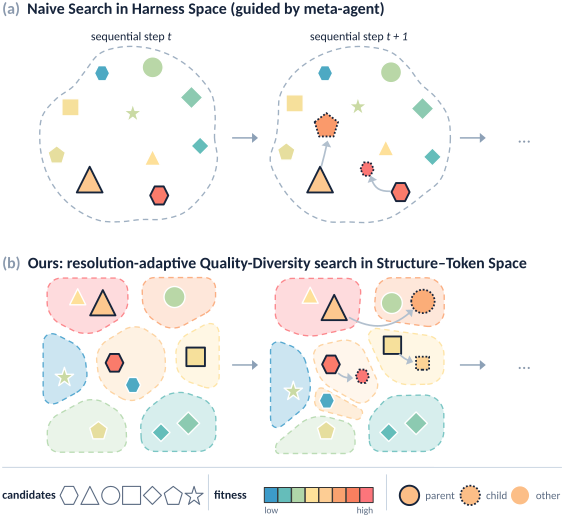
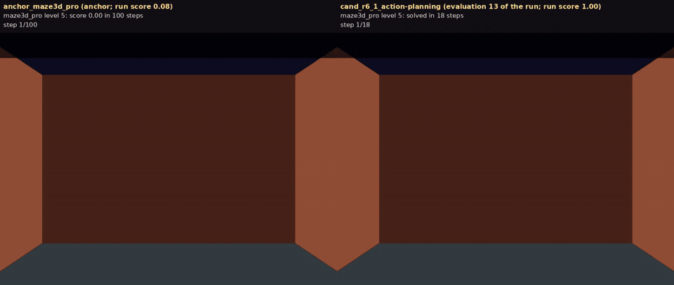
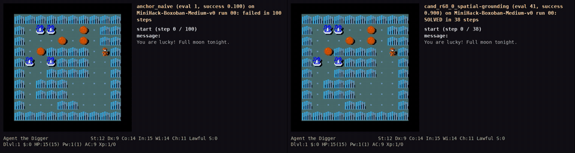
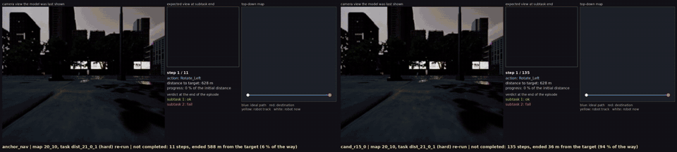

<h1 align="center">Harness-MAP</h1>
<h3 align="center">Budget-Efficient Harness Search via Structure-Token Factorization</h3>

<p align="center">
  <a href="https://harness-map.github.io/"></a>
  <a href="https://drive.google.com/file/d/1y0b185BGWgLylrryYU_cPm4ZFyRX8sHR/view?usp=sharing"></a>
  <a href="https://x.com/"></a>
</p>
<!-- TODO: point the Paper badge at the arXiv abstract page once the id is assigned, and the X badge at the announcement thread. -->

---

**Harness-MAP** evolves the harness around a frozen base model, the orchestration code, prompts, skills, tools and memory, under a tight budget of harness evaluations: a meta-agent proposes, judges and diagnoses harnesses, and Harness-MAP keeps every candidate on a quality-diversity map keyed by a structural descriptor of the harness source, breeds from many cells at once and refines the map where fitness varies. With `Qwen3-VL-30B-A3B-Instruct` frozen, 50 evaluations take task success from 10.7% to 100.0% on SpatialWorld's 3D games and from 10.0% to 90.0% on BALROG-MiniHack, and 16 take subtask success from 29.0% to 55.5% on hard SimWorld-MMNav, ahead of Meta-Harness, GEPA, the Darwin Gödel Machine, OpenEvolve and ShinkaEvolve under the same budget.

<p align="center"></p>

<p align="center"><sub><b>Figure 1.</b> <b>(a)</b> A meta-agent searching harness space directly follows one lineage at a time and collapses into local edits. <b>(b)</b> Harness-MAP places every candidate in a structure–token map, breeds from many cells at once, and sub-splits the cells whose fitness varies as the search proceeds.</sub></p>

<table>
<tr>
<td width="66%"></td>
<td width="34%"><b>SpatialWorld maze3d_pro, level 5.</b> The anchor, SpatialWorld's shipped agent, roams the two-floor maze for 100 steps without finding the exit and solves 2 of the game's 25 levels. The 13th harness of the run, bred along the <em>action-planning</em> axis, exits in 18 steps and solves all 25. <em>Qwen3-VL-30B-A3B-Instruct, pure-visual variant.</em></td>
</tr>
<tr>
<td></td>
<td><b>BALROG MiniHack-Boxoban-Medium, episode 00.</b> BALROG's naive agent pushes boulders for 100 steps without solving the level (success 0.100 over the 40 search episodes). The run's best harness, <code>cand_r68_0</code> (evaluation 41), plans the pushes over the parsed map and solves it in 38 steps (success 0.900).</td>
</tr>
<tr>
<td></td>
<td><b>SimWorld-MMNav hard, map 20_10, task dist_21_0_1.</b> The anchor declares arrival after 11 steps, 588 m short of the destination. The best harness, <code>cand_r15_0</code> (evaluation 16), follows the street for 135 steps to within 36 m of it (a re-run of the task with the same base model). Subtask success 0.360 → 0.555 on the 50 search tasks.</td>
</tr>
</table>

The three clips are task examples of [`tests/`](tests/README.md), which holds every harness of the three lineages with the proposer's notes and the diagnostician's reports, the evaluators that score them, and the outcomes to expect.

## Overview

A search runs as follows, with an evaluation budget of **N = ⌈m·k0⌉ + G·P·C** (P = ⌈log2 k0⌉ in the paper):

1. **Partition.** The descriptor φ is computed for the anchor harness and a small corpus of variants of it, and one k-means over the descriptors gives a CVT partition with k0 cells. The partition is then frozen.
2. **Coverage-gated initialization.** The proposer is aimed at empty cells until ⌈m·k0⌉ cells are covered. Placing a candidate only reads its source, so it is free; only covering candidates are evaluated.
3. **Generations.** For each of G generations, P parent cells are selected, the meta-agent proposes C children per parent, and every child passes a static pre-evaluation gate, is evaluated on the task set, reviewed by the LLM judge for reward hacking, diagnosed, and placed in its nearest cell.
4. **Resolution control.** `mapelites_adaptive` splits a cell whose fitness range exceeds 2σ and retreats when no descendant beats the pre-split elite by 2σ; `mapelites_hier` re-partitions coarse to fine on a schedule (Mouret & Clune, 2015); `mapelites_fixed` keeps the partition (Vassiliades, Chatzilygeroudis & Mouret, 2018). The three modes differ *only* here, so a difference between them is attributable to resolution.

- **Harness.** A directory with a fixed skeleton: `agent.py` (entry point), `AGENT.md`, `rules.md`, `memory.md`, `skills/*.md` and `tools/*.py`. The skeleton is specified to the meta-agent in `harness_map/meta_agent/skills/proposer/SKILL.md`; a benchmark supplies the content.
- **Meta-agent.** Three skill-driven roles. The *proposer* edits a copy of the parent harness. The *judge* reviews an evaluated candidate's code and traces for reward hacking. The *diagnostician* writes `diagnosis.md`, which the next proposer reads as its gradient.
- **Descriptor φ.** Weisfeiler–Lehman features of the harness's component graph (structure), plus AST statistics, numeric-constant statistics and a sentence embedding of the harness's documentation text. Each block is standardized and scaled by 1/√dim.

### The paper's runs

| | BALROG-MiniHack | SpatialWorld 3D games | SimWorld-MMNav |
|---|---|---|---|
| **anchor → best harness** | 10.0% → 90.0% task success | 10.7% → 100.0% task success (five games) | hard 29.0% → 55.5%, easy 32.0% → 46.5% subtask success |
| **harness evaluations to the best** | 41 (N = 50) | 39 (N = 50) | 16 (N = 16) |
| directory | `tests/examples/balrog/` | `tests/examples/spatialworld_games/` | `tests/examples/simworld_nav/` |
| upstream | [BALROG](https://github.com/balrog-ai/BALROG) at b7afe79 | [SpatialWorld](https://github.com/Hongcheng-Gao/SpatialWorld) at 8e10e24 + `spatialworld.patch` | [SimWorld-Robotics](https://github.com/SCAI-JHU/SimWorld-Robotics) + the SimWorld UE simulator |
| search set | the 8 official MiniHack tasks × 5 episodes (40 episodes per evaluation) | one game per run: maze 20, block3d 20, maze3d_pro 25, rubik 20, snake 20 levels | 50 tasks (maps 20_0–20_24), hard or easy setting |
| held-out set | the same 8 tasks on unseen level seeds (`holdout_levels`); 8 unseen tasks (`holdout_tasks`) | snake only: 5 unseen seeds | 10 tasks (maps 20_25–20_29) |
| primary metric | `success`: fraction of episodes ending in TASK_SUCCESSFUL | per-level success for maze / block3d / maze3d_pro / rubik; `min(food eaten / 4, 1)` for snake | `SubtaskSR`: mean fraction of completed subtasks (`SR` kept as a dense field) |
| selection key | primary, survival, step efficiency, taint, judge, cost | primary, taint, judge, cost | primary, subtask SR, progress score, taint, judge, distance progress, cost |
| anchor | BALROG's published naive agent, unchanged, in the harness layout | SpatialWorld's shipped per-step agent, with its prompt split into `AGENT.md` / `skills/*.md` / `rules.md` | the ReAct baseline agent run through a multi-module harness (perceiver, spatial memory, planner, prompt assembler, active perception, completion checker) |
| budget N | 50 | 50 | 16 |
| k0 swept | 2, 4, 8, 16, 32 | 2, 4, 8, 16, 32 | 2, 4, 8 |
| C (children per parent) | 2 for k0 ≤ 4, 1 for k0 ≥ 8 | 2 for k0 ≤ 4, 1 for k0 ≥ 8 | 1 |
| G (generations), by k0 | 24 / 12 / 15 / 10 / 6 | 24 / 12 / 15 / 10 / 6 | 15 / 7 / 4 |
| coverage-gated init | strict | strict | lenient (continues on a shortfall) |
| LLM judge | on (evaluates through `evaluate_batch`) | off: static gate + runtime guard | off: static gate |
| extra anti-cheat | static scan for env internals, level files, goal positions and the success flag | episode voided if the harness reads engine state (other than the frame), reads level files, or never calls the model | static scan for agent/target location, ideal path, instruction; an evaluation with fewer episodes than the split is invalid |
| role keywords for φ | perception, memory, navigate, explore, hazard, controller | default rules | default rules |
| per-evaluation timeout | 4 h | 10 h | 18 h |

Shared by all three: the base model is `Qwen3-VL-30B-A3B-Instruct` served by vLLM (frozen; only the harness evolves); the meta-agent is the Claude Code CLI (`cli:claude`, 3 h per call); P = ⌈log2 k0⌉ parents per generation; m = 0.5, so ⌈k0/2⌉ cells are covered before generation 1; σ = 0; the proposer is steered; the CVT is fit once per benchmark and then frozen for every mode and k0. `run_benchmark.py` fits it on the anchor plus meta-agent variants of it; the paper's BALROG runs instead fit it on a fixed corpus of 48 structural variants of the naive anchor (tool modules inlined or split out, text priors filled or empty), which `--corpus DIR` accepts.

Deviations from the official benchmarks: the 3D games run a **pure-visual variant** (`spatialworld.patch` strips on-screen position, cursor, axis and move-hint text from block3d, maze3d_pro and snake; maze keeps its engine's position-and-heading bar), so their scores are not comparable with the SpatialWorld leaderboard; navigation uses a 50/10 search/held-out split of the SimWorld-MMNav tasks rather than the full set; BALROG's search scores every candidate on fixed per-(task, episode) seeds so all candidates play the same levels. The paper compares against Meta-Harness, GEPA, the Darwin Gödel Machine, OpenEvolve and ShinkaEvolve, each run from the authors' pinned implementation with the same anchor, meta-agent, evaluator, task splits, anti-cheat gate and budget; the [project page](https://harness-map.github.io/) has the full tables and the evolved harnesses.

## Structure

```
harness_map/                   the method
├── main.py                    Genome/Fitness types, config defaults, run(), the adapter protocol,
│                              Node/Ctx, evaluation gates, fitness_from_dir; re-exports qd/'s names
├── qd/
│   ├── descriptors.py         φ: roles, component graph, WL, AST / numeric / doc-text blocks
│   ├── partition.py           k-means, CVT fit (fit_cvt_blocks), frozen φ (make_phi_blocks), ladder
│   ├── coverage.py            coverage-gated initialization
│   ├── archive.py             cells, placement, elites, refine / retreat / advance, steering; breeding one generation
│   └── modes.py               the three CVT drivers, the N = ⌈m·k0⌉ + G·P·C accounting, run_frontier,
│                              the per-evaluation ledger and resume from a snapshot
└── meta_agent/
    ├── agent.py               MetaAgent, propose_candidates, run_judge, run_diagnosis, AgenticAdapter
    └── skills/{proposer,diagnostician,judge}/SKILL.md
tests/                         the paper's benchmarks, hands on (README)
├── tasks/<benchmark>/         evaluate.py, the evaluator of the paper's runs (--harness DIR --tasks TASKS.json --out OUT),
│                              one task record per example, a preview frame, expected.json (what every shipped
│                              harness scored on it), README
└── examples/
    ├── run_benchmark.py       generic driver: config + anchor + evaluator command → one search
    ├── adapter_example.py     a custom adapter skeleton, with the adapter protocol documented
    ├── balrog/                BALROG-MiniHack: config.json, run.sh, README (setup),
    │                          evolution/ (every harness of the paper's best run, with videos)
    ├── spatialworld_games/    SpatialWorld 3D games: config.json, run.sh, spatialworld.patch,
    │                          README, evolution/<game>/ (the best run of each game, with videos)
    ├── simworld_nav/          SimWorld-Robotics navigation: config.json, run.sh, README,
    │                          evolution/ (the best hard-setting run, with videos)
    └── render/                episode logs → videos: replay_balrog_episode.py and
                               replay_rubik_episode.py (engine replays), render_balrog_episode.py
                               (text frames), render_nav_trace.py, grid_videos.py (2×2 grids)
assets/                        the method figure and the clips above
pyproject.toml                 the harness_map package (pip install -e .)
```

Each `evolution/` directory is laid out as `README.md`, `lineage.json`, `harnesses/<NN>_<label>/` (the harness as evaluated, its `NOTES.md` and `diagnosis.md`) and `videos/`. A search writes `runs/<testbed>/<split>/<mode>_k<k0>/`: `result.json` (every evaluated harness with its `Fitness`, the best, and the mode's report with the final cell table, split/retreat and steering logs, the budget and coverage reports), `candidates/` (one directory per proposed harness), `evals/` (the evaluator's score files and traces) and `checkpoints/` (the per-evaluation ledger and the resume snapshot).

## Quickstart

### Install

```bash
git clone https://github.com/Harness-MAP/harness-map.git
cd harness-map
pip install -e .              # numpy, sentence-transformers, einops
pip install -e ".[openai]"    # optional: the chat-loop meta-agent backbone
```

Python 3.10 or newer. The descriptor downloads `nomic-ai/CodeRankEmbed` through sentence-transformers (with `trust_remote_code=True`) on first use and runs it on CPU; set `META_EMB_MODEL` to use a different model.

### Set up a benchmark

The benchmarks are not redistributed. Install each one in its own environment as its README under `tests/examples/` describes, and serve the base model with vLLM. The evaluators the paper's runs used are in `tests/tasks/<benchmark>/evaluate.py`; they drive the benchmark's own runner and are configured through the environment variables listed in [`tests/tasks/README.md`](tests/tasks/README.md).

| Benchmark | `tests/examples/` | Repository | Base model |
|---|---|---|---|
| SpatialWorld 3D games | [`spatialworld_games/`](tests/examples/spatialworld_games/README.md) | [Hongcheng-Gao/SpatialWorld](https://github.com/Hongcheng-Gao/SpatialWorld) at 8e10e24, with `spatialworld.patch` | `Qwen3-VL-30B-A3B-Instruct` on vLLM |
| BALROG-MiniHack | [`balrog/`](tests/examples/balrog/README.md) | [balrog-ai/BALROG](https://github.com/balrog-ai/BALROG) at b7afe79 | `Qwen3-VL-30B-A3B-Instruct` on vLLM |
| SimWorld-MMNav | [`simworld_nav/`](tests/examples/simworld_nav/README.md) | [SCAI-JHU/SimWorld-Robotics](https://github.com/SCAI-JHU/SimWorld-Robotics) and the [SimWorld](https://github.com/SimWorld-AI/SimWorld) UE simulator | `Qwen3-VL-30B-A3B-Instruct` on vLLM |

The meta-agent is the Claude Code CLI (`claude` on `PATH`) by default; `cli:codex` and `chat-loop` are the alternatives (see [Meta-agent backbones](#meta-agent-backbones)).

### Run a benchmark of the paper

Set the interpreter and server variables at the top of the benchmark's `run.sh`, then:

```bash
MODE=adaptive K0=4 bash tests/examples/balrog/run.sh
GAME=maze3d_pro MODE=adaptive K0=8 bash tests/examples/spatialworld_games/run.sh
SETTING=hard MODE=adaptive K0=4 bash tests/examples/simworld_nav/run.sh
```

`MODE` is `adaptive` (the method), `fixed` or `hier` (the resolution ablations) and `K0` the initial cell count. An interrupted run continues with `--resume` on the same `--run-dir`.

### Replay a task example

Any shipped harness runs on a task example of [`tests/tasks/`](tests/tasks/README.md) through the same evaluator; `expected.json` next to the record gives the outcome every shipped harness obtained on it:

```bash
export SPATIALWORLD_REPO=/path/to/SpatialWorld GAME_API_BASE=http://127.0.0.1:8000/v1
"$GAME_PYTHON" tests/tasks/spatialworld_games/evaluate.py \
    --harness tests/examples/spatialworld_games/evolution/maze3d_pro/harnesses/12_cand_r6_1_action-planning \
    --tasks   tests/tasks/spatialworld_games/maze3d_pro_level_05.json \
    --out     /tmp/maze3d_pro_level_05
```

### Run on your own benchmark

A benchmark plugs in through four pieces; the search itself (`main.py`, `qd/`, `meta_agent/`) is never edited.

1. **Anchor harness**, in the fixed skeleton the proposer skill relies on. Your evaluator decides how `agent.py` is run; the search also accepts the older name `harness.py`.

   ```
   harnesses/<task>/
   ├── agent.py           entry point (your evaluator imports and runs it)
   ├── AGENT.md           role and task framing, verified facts about the observations
   ├── rules.md           output contract, legal actions, anti-cheat rule
   ├── memory.md          per-step scratchpad template
   ├── skills/*.md        composable text priors, one concern per file
   ├── tools/*.py         executable helpers called by agent.py
   └── NOTES.md           module map and the list of evolvable levers
   ```

2. **Evaluator**: a command `evaluator.py --harness DIR --tasks TASKS.json --out OUT` that runs the frozen base model with the harness on the task records and writes `OUT/score.json`; the three under `tests/tasks/` are templates. Keep a search split and a held-out split, and wrap any environment object that exposes ground truth so that only sanctioned methods are reachable.

3. **Config**, a JSON file merged over `harness_map.main.DEFAULTS`:

   ```jsonc
   {
     "meta_agent": { "backbone": "cli:claude", "timeout_s": 10800 },   // or cli:codex / chat-loop
     "score_file": "score.json",
     "fitness":    { "primary": "success", "n": "n_episodes" },        // score-file fields -> Fitness
     "episode":    { "list_key": "per_episode", "task_id": "episode", "primary": "success" },
     "rubric_labels": [],                                              // names of the per-task vector
     "selection":  { "greedy_key": [["primary", "desc"], ["judge", "asc"]] },
     "audit":      { "privileged_keys": ["full_state"], "judge_file": "judge.json" },  // fields a harness must never read
     "roles":      { "extra": [] }                                     // extra [role, [keywords]] for φ
   }
   ```

   `fitness` and `episode` map your score file onto `Fitness`; `audit.privileged_keys` is the anti-cheat vocabulary the static gate scans for; `roles.extra` adds `[role, [keyword, ...]]` pairs so φ's structure block follows your benchmark's naming. `run_benchmark.py` additionally reads `search` (mode, k0, budget or rounds, children, m, strict_coverage), `benchmark` (the evaluator command template with `{harness}`, `{tasks}`, `{out}` and `{split}`, the split names, timeout, whether to judge) and `splits`.

4. **Adapter.** `run_benchmark.py`'s `CommandAdapter` covers an evaluator command. For in-process evaluation, your own batching or a different judge policy, subclass `AgenticAdapter` as in [`tests/examples/adapter_example.py`](tests/examples/adapter_example.py), which documents the protocol: `anchor()` and `evaluate()` are required, `evaluate_batch()` routes candidates through the LLM judge, `privileged_keys()` names what a harness must never read, `evaluate_holdout()` scores the final harness.

### Search knobs

| knob | meaning |
|---|---|
| `k0` | number of CVT cells (set when fitting the partition) |
| `random_init` | m: fraction of the k0 cells that coverage-gated initialization must fill |
| `rounds` | G: number of generations |
| `batch_size` | P: parents bred per generation |
| `children_per_parent` | C: children proposed per parent |
| `max_evals` | N: stop once this many evaluations have been charged |
| `sigma` | adaptive only: noise floor σ (default 0); splits and retreats use a 2σ threshold |
| `k_split`, `depth_cap`, `patience` | adaptive only: children per split, maximum split depth, breeding turns before a split is judged |
| `steer` | add a search-space direction to each proposer brief |

### Meta-agent backbones

| backbone | how it runs |
|---|---|
| `cli:claude` | Claude Code CLI: `claude -p --permission-mode bypassPermissions` (`CLAUDE_BIN` overrides the binary) |
| `cli:codex` | Codex CLI: `codex exec ... --dangerously-bypass-approvals-and-sandbox` (`CODEX_BIN` overrides the binary) |
| `chat-loop` | any OpenAI-compatible chat API with four tools (read_file, write_file, list_dir, run_bash); reads `OPENAI_API_KEY`, `OPENAI_BASE_URL`, `OPENAI_META_MODEL` |

All three read the same SKILL.md files and produce the same result: an edited candidate directory plus a sentinel file (`NOTES.md`). The command line of each CLI backbone is configurable through `meta_agent.cli_cmd`.

> **Security.** The meta-agent edits files and runs shell commands without approval prompts. Run searches inside a container or VM where only the run directory is writable, and keep credentials out of the harness and task directories.

## Citation

```bibtex
@article{yuan2026harnessmap,
  title   = {Harness-MAP: Budget-Efficient Harness Search via Structure-Token Factorization},
  author  = {Yuan, Mei and Chang, Yingshan and Fried, Daniel and Bisk, Yonatan},
  journal = {arXiv preprint},
  year    = {2026}
}
```

<!-- TODO: add the arXiv identifier to the entry and a LICENSE file to the repository. -->

## Acknowledgement

The experiments build on three benchmarks and their simulators: [BALROG](https://github.com/balrog-ai/BALROG) with [MiniHack](https://github.com/samvelyan/minihack) and the [NetHack Learning Environment](https://github.com/heiner/nle), [SpatialWorld](https://github.com/Hongcheng-Gao/SpatialWorld), and [SimWorld-Robotics](https://github.com/SCAI-JHU/SimWorld-Robotics) with the SimWorld Unreal Engine simulator. The base model is [Qwen3-VL](https://github.com/QwenLM/Qwen3-VL) served with [vLLM](https://github.com/vllm-project/vllm), and the descriptor's text block uses [CodeRankEmbed](https://huggingface.co/nomic-ai/CodeRankEmbed) through [sentence-transformers](https://github.com/UKPLab/sentence-transformers).

The paper's baselines were run from the authors' own implementations of [Meta-Harness](https://github.com/stanford-iris-lab/meta-harness), [GEPA](https://github.com/gepa-ai/gepa), the [Darwin Gödel Machine](https://github.com/jennyzzt/dgm), [OpenEvolve](https://github.com/algorithmicsuperintelligence/openevolve) and [ShinkaEvolve](https://github.com/SakanaAI/shinkaevolve); we thank their authors for releasing them. The archive follows MAP-Elites (Mouret & Clune, 2015) and CVT-MAP-Elites (Vassiliades, Chatzilygeroudis & Mouret, 2018).
