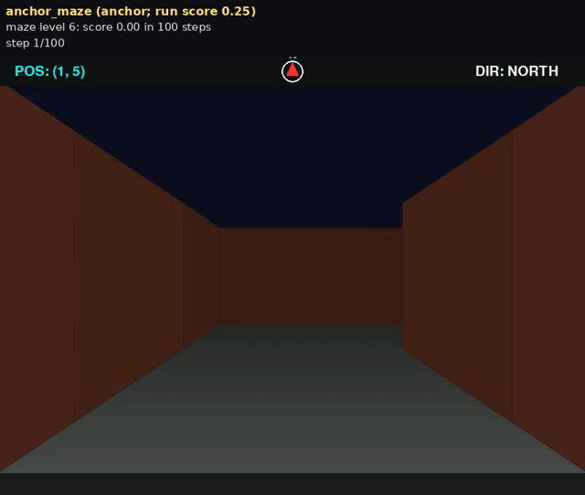
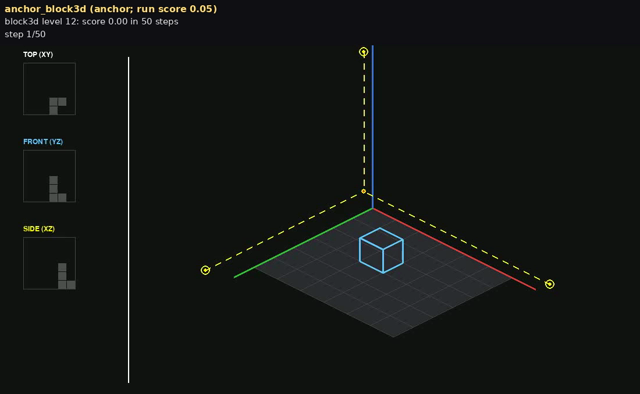
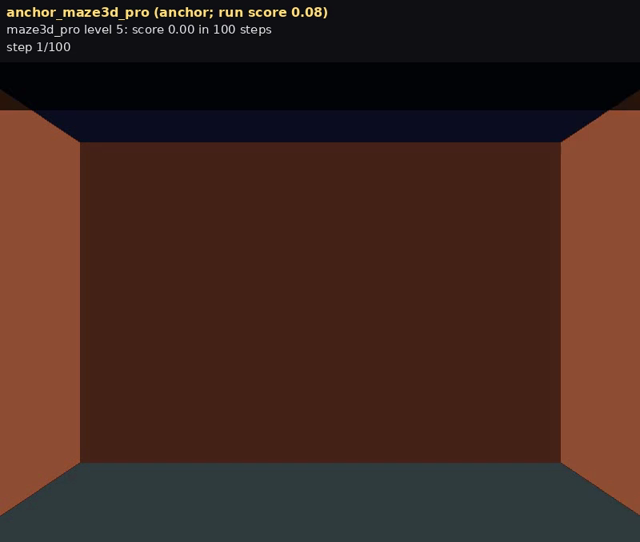
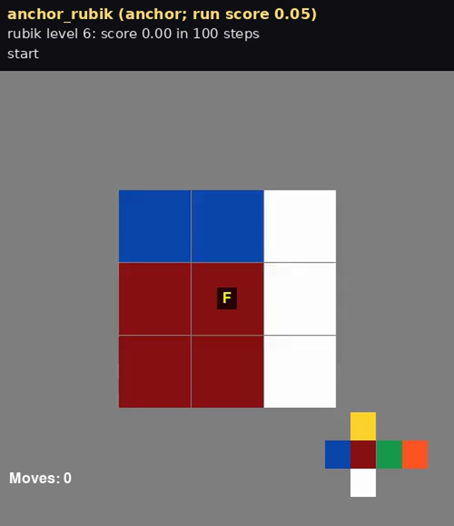
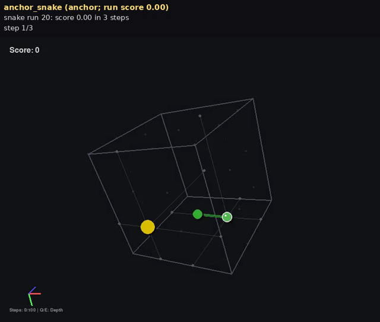
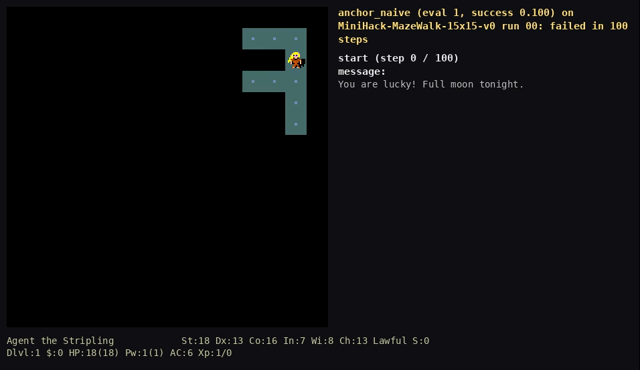
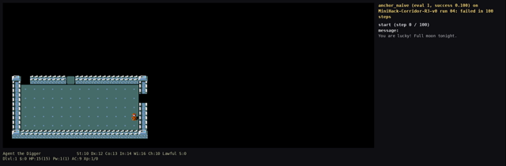
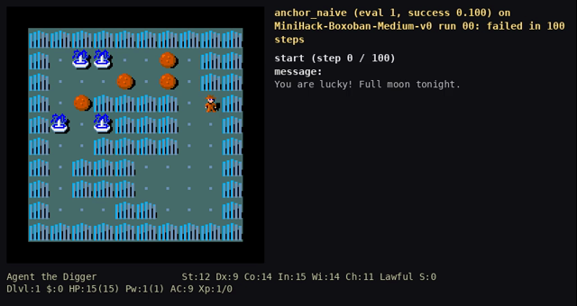
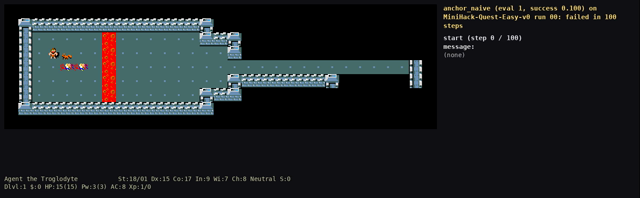
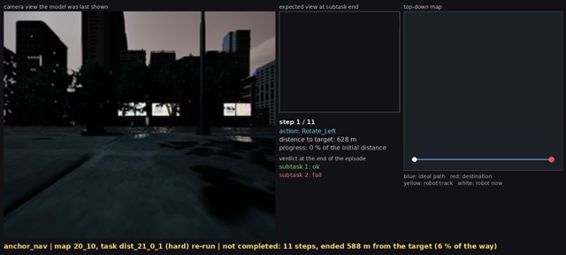

# Evaluators and task examples

For each benchmark of the paper, this directory holds the evaluator the paper's runs used, one task
example per video of the evolution packs (the task record in the format the evaluator takes, a
preview frame, and the outcome of every harness shown in the videos), and `expected.json`, the
outcomes in machine-readable form. The harnesses and the videos are under
[`../examples/<benchmark>/evolution/`](../README.md). Evaluation numbers count the anchor as 1.

The task definitions themselves (level files, map files) belong to the benchmarks and are not
redistributed; each section says where they live.

## Evaluators

The three `evaluate.py` scripts share one interface and drive the benchmark's own runner with the
frozen base model; `run_benchmark.py` calls them during a search (through each benchmark's `run.sh`)
and they run a single task example just as well:

```bash
python tests/tasks/<benchmark>/evaluate.py --harness DIR --tasks TASKS.json --out OUT
```

`--harness` is a harness directory (`agent.py`, or the older `harness.py`), `--tasks` a JSON list of
task records (a split of the benchmark's `config.json`, or one of the task-example files here), and
`OUT/score.json` receives the score the search reads (the fields `config.json` names under `fitness`
and `episode`) plus per-episode rows. Each evaluator runs under its benchmark's interpreter and is
configured through environment variables:

| | SpatialWorld 3D games | BALROG-MiniHack | SimWorld-MMNav |
|---|---|---|---|
| script | [`spatialworld_games/evaluate.py`](spatialworld_games/evaluate.py), one [`episode.py`](spatialworld_games/episode.py) subprocess per episode | [`balrog/evaluate.py`](balrog/evaluate.py) | [`simworld_nav/evaluate.py`](simworld_nav/evaluate.py) (+ `unrealcv_patch.py`) |
| what it reuses | SpatialWorld's per-game `*OpenAIEvaluator` classes; the harness's `build_agent(evaluator)` replaces the per-step decision | BALROG's `EvaluatorManager` with the harness's `build_agent(client_factory, prompt_builder)` as the agent factory; one runtime patch fixes the seed per (task, episode) | the SimWorld-Robotics gym over UnrealCV; the harness's `run_episode(env, task_spec, vlm_clients, trace_dir)` |
| benchmark checkout | `SPATIALWORLD_REPO` (8e10e24 with `spatialworld.patch`) | `BALROG_REPO` (b7afe79) | `SIMWORLD_ROBOTICS_REPO`; `SIMWORLD_SETTINGS_DIR` (the extracted test settings), `SIMWORLD_BASELINE_DIR` |
| base model | `GAME_MODEL`, `GAME_API_BASE` (comma-separated servers spread the episodes), `GAME_API_KEY` | `BALROG_MODEL`, `BALROG_API_BASE` | `NAV_MODEL`, `NAV_API_BASE`, or `EVAL_ALLOWED_MODELS` (a JSON pool file) |
| parallelism and limits | `GAME_EVAL_WORKERS`, `GAME_EPISODE_TIMEOUT_S` (1800), `GAME_MAX_STEPS`, `GAME_MAX_TOKENS`, `SPATIALWORLD_MAX_IMAGES` (32), `HISTORY_WINDOW` | `BALROG_WORKERS` (8), `--episodes`, `--step-cap` (100) | `UE_PORT` (9000), `--setting hard|easy` (`NAV_SETTING`), `EVAL_RESET_TIMEOUT_S`, `EVAL_STALL_LIMIT_S`, `VLM_CALL_TIMEOUT_S`, `MAX_VLM_CALLS_PER_STEP`, `SIM_LAUNCHER` + `EVAL_SIM_RESTART_EVERY` |
| anti-cheat | `ANTICHEAT_GUARD` (default 1): an episode is voided when the harness reads engine state other than the frame, reads the level files, or never calls the base model | fixed seeds (`seed_base`, `BALROG_SEED_BASE`); the LLM judge runs in the search | a read audit of the environment info the harness touched (`read_audit.json`) |
| writes | `score.json` (`score`, `n_episodes`, `per_episode`, `voided`), `episodes/<task>/` | `score.json` (`success`, `progression`, `survival_rate`, `step_efficiency`, `per_task_vector`, `per_episode`, `seeds`), BALROG's per-episode files | `score.json` (`SubtaskSR`, `SR`, `per_position_SR`, `distance_progress_mean`, `per_episode`), `traces/ep_<map>_<task>/`, `source/` |

All defaults point at `Qwen3-VL-30B-A3B-Instruct` on `http://127.0.0.1:8000/v1` and at checkouts
under `~/workspace/`. The full variable list is in each script's docstring.

## SpatialWorld 3D games

Records: `{"task_id": "<game>/level_NN", "game": "<game>", "level": NN}`, or `"seed"` for snake.
The levels are defined in [SpatialWorld](https://github.com/Hongcheng-Gao/SpatialWorld) at commit
8e10e24; the paper's runs use the pure-visual variant (see
[`../examples/spatialworld_games/README.md`](../examples/spatialworld_games/README.md)).
[`spatialworld_games/expected.json`](spatialworld_games/expected.json) holds the outcomes below.

| task example | record | the task | anchor → shown harnesses (evaluation) |
|---|---|---|---|
| <br>maze, level 6 | [`maze_level_06.json`](spatialworld_games/maze_level_06.json) | a 7×7 first-person maze (`data/game/maze3d/Level_06.txt`): reach the exit within 100 steps | anchor: failed in 100 steps → `cand_r1_0` (2): solved in 48 → `cand_r2_0` (3): 20 → `cand_r4_0` (4): 10 |
| <br>block3d, level 12 | [`block3d_level_12.json`](spatialworld_games/block3d_level_12.json) | a five-block target configuration (`LEVEL_DESIGNS["12"]` in `data/Block3D/level_data.py`); 50-step cap | anchor: score 0 in 50 steps → `cand_r1_0` (2): 0 → `cand_r3_0` (3): solved in 15 → `cand_r4_0` (4): 15 |
| <br>maze3d_pro, level 5 | [`maze3d_pro_level_05.json`](spatialworld_games/maze3d_pro_level_05.json) | two 7×7 floors with the exit on the other floor (`data/game/maze3d_pro/Level_05.txt`); 100-step cap | anchor: failed in 100 steps → `cand_r2_1` (5): failed → `cand_r4_0` (8): solved in 56 → `cand_r6_1` (13): 18 |
| <br>rubik, level 6 | [`rubik_level_06.json`](spatialworld_games/rubik_level_06.json) | a cube scrambled by two quarter turns, U' then R (`INITIAL_CONFIGS["6"]` in `data/rubik_cube/scramble_data.py`); solve within 100 steps | anchor: failed in 100 steps → `cand_r1_0` (2): failed → `cand_r2_0` (3): solved in 28 → `cand_r2_1` (4): 4 |
| <br>snake, run 20 | [`snake_run_020.json`](spatialworld_games/snake_run_020.json) | snake with seed 20 (the seed fixes the food placement); score = min(food eaten / 4, 1), 100-step cap | anchor: 0 (game over at step 3) → `cand_r1_0` (2): 0.25 → `cand_r2_0` (3): 0.25 → `cand_r3_0` (4): 1.0 in 16 steps |

## BALROG-MiniHack

Records: `{"task_id": "<MiniHack task>", "episodes": n, "seed_base": 0}`, the search split's record
for one task. The evaluator seeds episode *i* of a task deterministically from `seed_base`, so
`episodes: 1` plays run 00 and Corridor-R3's run 04 needs `episodes: 5` (its fifth episode). The
engine seeds BALROG logged for these episodes in the paper's run are given below; with them,
[MiniHack](https://github.com/samvelyan/minihack) reproduces the exact level directly. The task
descriptions are BALROG's (`balrog/config/config.yaml` at b7afe79).
[`balrog/expected.json`](balrog/expected.json) holds the outcomes below.

| task example | record | the task | anchor → `cand_r35_0` (8) → `cand_r41_0` (14) → `cand_r68_0` (41) |
|---|---|---|---|
| <br>MazeWalk-15x15, run 00 | [`MiniHack-MazeWalk-15x15-v0_run00.json`](balrog/MiniHack-MazeWalk-15x15-v0_run00.json) | reach the staircase through a 15×15 maze; engine seed 360437341 | failed in 100 steps → failed → solved in 70 → solved in 70 |
| <br>Corridor-R3, run 04 | [`MiniHack-Corridor-R3-v0_run04.json`](balrog/MiniHack-Corridor-R3-v0_run04.json) | reach the staircase through three rooms linked by unlit corridors; engine seed 3971796377 | failed in 100 steps → solved in 67 → solved in 41 → solved in 41 |
| <br>Boxoban-Medium, run 00 | [`MiniHack-Boxoban-Medium-v0_run00.json`](balrog/MiniHack-Boxoban-Medium-v0_run00.json) | a Sokoban level: push every boulder onto a fountain; engine seed 291150209 | failed in 100 steps → failed → failed → solved in 38 |
| <br>Quest-Easy, run 00 | [`MiniHack-Quest-Easy-v0_run00.json`](balrog/MiniHack-Quest-Easy-v0_run00.json) | cross a river of lava with the items in the inventory and reach the staircase; engine seed 255275049 | failed in 100 steps → failed → failed → solved in 48 |

## SimWorld-MMNav, hard setting

Record: `{"map": "20_10", "task": "task_dist_21_0_1"}`. The task's files (`task_config.json`,
`roads.json`, `progen_world.json`, `map.png`, `traffic.json`) are in the SimWorld-MMNav test
settings, Hugging Face dataset `jise/simworld-20k`, file `test_settings/single_test.tar.gz`, under
`single_agent_world/hard/map_road_20_10/task_dist_21_0_1/`, which is where `SIMWORLD_SETTINGS_DIR`
points. [`simworld_nav/expected.json`](simworld_nav/expected.json) holds the outcomes below.



**The task.** A Spot quadruped spawns at x = −102 m, y = −17 m on a straight street facing yaw 90°
and must stop within 20 m of the destination at x = 525 m, y = −17 m, 628 m away, within 1336
steps. Two subtasks are scored by the environment's checker: ORIENTATION, "Turn to face west. You
will see a gray and white residential building with multiple glass doors on your left.", and
FINISH, "Proceed forward until reaching the high gray concrete building with small striped awnings
over the ground-level entrances on your left, stop and face that building." The hard setting adds
five vehicles and five pedestrians.

| harness (evaluation) | re-run shown in the video | campaign evaluation of this task |
|---|---|---|
| `anchor_nav` (1) | orientation passed, then an arrival commit after 11 steps, 588 m from the destination (6 % of the way) | the same: 11 steps, 588 m |
| `cand_r9_0_spatial-grounding` (10) | 233 steps along the street to the step cap, 487 m from the destination (22 %) | 40 steps, 448 m (29 %) |
| `cand_r13_0_spatial-grounding` (14) | the same trajectory as `cand_r9_0`: 233 steps, 487 m (22 %) | 131 steps, 463 m (26 %) |
| `cand_r15_0_spatial-grounding` (16) | 135 steps along the route to 36 m from the destination (94 %), then an arrival commit; the destination check did not fire | completed in 135 steps |

The re-runs use the same base model and evaluator settings as the campaign; the model samples at
every step, so a re-run is a fresh draw rather than a replay. The video of `cand_r15_0` is the
closest of four re-runs (46 m, 268 m, 428 m and 36 m from the destination).
